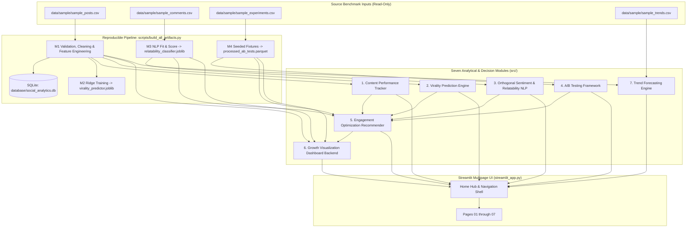

# SocialPulse — An Intelligent Social Media Analytics & Engagement Optimization Platform

[-3776AB.svg)](https://www.python.org/)
[](https://streamlit.io/)

[](LICENSE)

**SocialPulse** is a modular Python Data Science and Decision-Support platform designed to analyze audience relatability, high-intent engagement behavior, controlled creative experimentation, and cohort trajectory forecasting across short-form social media platforms (**Instagram**, **TikTok**, and **YouTube Shorts**).

---

## 📌 Executive Summary & Benchmark Scope

Conventional creator dashboards rely heavily on passive vanity metrics such as raw likes or unsegmented impressions. **SocialPulse** replaces guesswork with an evidence-tiered analytical pipeline prioritizing high-intent engagement signals (**Shares**, **Saves**, and **Watch Retention**) alongside strict statistical, temporal, and platform-isolation guardrails.

> **Important Provenance & Operational Mode:**
> Clean checkouts start deterministically with curated **Offline Synthetic Benchmark Fixtures** ([`data/sample/`](data/sample/)) bootstrapped via [`scripts/build_all_artifacts.py`](scripts/build_all_artifacts.py). When optional external corpora are downloaded and normalized locally into `data/processed/external/` via [`scripts/download_external_datasets.py`](scripts/download_external_datasets.py) and [`scripts/prepare_external_datasets.py`](scripts/prepare_external_datasets.py), a unified sidebar dataset switcher seamlessly selects across synthetic fixtures and prepared real/external corpora while surfacing explicit provenance, license, proxy-metric, and causality disclosures. Platform API connectors (`InstagramGraphAPIConnector`, `YouTubeDataAPIConnector`) and scraper interfaces (`SocialMediaScraper`) define schema-validated contract boundaries without embedding live OAuth tokens or automated scrapers.

---

## 🎓 Project Origin & Provenance

SocialPulse originated as *"The Data-Driven Social Engagement Initiative"* and evolved into a 7-module multi-platform analytics, statistical experimentation, orthogonal NLP, and walk-forward forecasting platform. The original academic problem statement PDF is archived at [`Problem_Statement/Data_Science_Major_Project_December.pdf`](Problem_Statement/Data_Science_Major_Project_December.pdf) (redistributed with owner-confirmed permission solely for academic context and provenance).

---

## 🏗️ System Architecture & Core Modules



### Module Breakdown

1. **Content Performance Tracker (`src/data_ingestion/`, `src/preprocessing/`, `src/analytics/`)**
   * Enforces the canonical **14-field unified post schema** (`UNIFIED_POST_FIELDS`) via pure Python/pandas validation (`DataValidator`), nullable pandas types (`Int64`, `Float64`), and snapshot-preserving deduplication on `(platform, post_id, collection_timestamp)`.
   * Preserves missing-value semantics (e.g., YouTube has `<NA>` for `saves` and never zero-imputes unavailable metrics) while computing availability-aware completeness and isolated views- vs. reach-based engagement rates.
   * Persists processed outputs to Parquet/CSV and SQLite (`database/social_analytics.db` with `latest_posts` view).

2. **Virality Prediction Engine (`src/modeling/virality_predictor.py`)**
   * Computes an ex-post **Engagement Virality Index (EVI)** — an availability-aware high-intent density metric normalizing observed weights across `shares` (`0.40`), `saves` (`0.35`), `comments_count` (`0.15`), and `likes` (`0.10`):

     $$
     \text{EVI} = \frac{\sum_{m \in \text{avail}} \tilde{w}_m \cdot x_m}{\text{Exposure} + \epsilon} \times 1000 \times \phi
     $$

     where $\epsilon = 100.0$, $\text{Exposure}$ selects the highest-priority observed denominator (`reach` -> `views` -> `impressions`), and the video retention multiplier $\phi = 0.5 + r$ applies when `retention_rate` $r \in [0, 1]$ on video formats (defaulting to $\phi = 1.0$ otherwise).
   * Trains a target-leakage-guarded **Ridge Regressor** strictly on pre-publication features (`PRE_PUBLICATION_FEATURES`, excluding outcome metrics and `day0_` / `day1_` / `day7_` / `day30_` snapshots) filtered to settled mature posts ($\ge 7$ days old, $N = 112$) using chronological train/test partitioning ($89/23$ split), benchmarked against a `DummyRegressor` mean baseline (`MAE` $20.91$ vs $35.41$; `RMSE` $27.48$ vs $38.52$; `Spearman` $\rho = 0.492$, $p = 0.017$; `empirical_residual_q95` $= 49.99$ points in `models/virality_predictor_metadata.json`). Also surfaces `Platform-Stratified Temporal Evaluation Coverage` (`Instagram` `test_samples = 0` `insufficient_evaluation_samples` and pooled/YouTube chronological $R^2 = -0.136$ on `N = 23`) in `app/pages/02_Virality_Prediction.py` Tab 2, and validates at scale on real longitudinal TikTok trajectories (`tiktok_engagement_200k`) without same-day/future creator leakage (`models/real_data_benchmarks.json`).

3. **Audience Sentiment & Relatability Analyzer (`src/nlp/`)**
   * Separates **Audience Identification (Relatability)** (`Relatable`, `Neutral`, `Uncertain`) from **Emotional Valence (Sentiment Polarity)** (`Positive`, `Negative`, `Neutral`, `Mixed`) as two orthogonal dimensions.
   * Relatability uses a **Multi-Tier Hybrid NLP Pipeline**:
     - *Layer 0 (Validation & Safety):* Discards empty text, flags insufficient context (pure emojis, short tokens), and detects non-English comments (`UNSUPPORTED_LANGUAGE`) rather than forcing English statistics.
     - *Layer 1 (Domain Heuristic Guardrails):* Filters technical camera/gear/music inquiries while anchoring explicit experiential phrases.
     - *Layer 2 (Statistical Classifier):* Sublinear TF-IDF word n-grams `(1, 2)` paired with class-weighted regularized Logistic Regression.
     - *Layer 3 (Uncertainty Boundary):* Flags ambiguous probabilities in $[0.42, 0.58]$ as `Uncertain`.
   * Sentiment uses a custom domain lexicon engine (`SentimentAnalyzer`) with negation flipping, intensifiers, and contrast weighting to classify `Positive`, `Negative`, `Neutral`, and `Mixed` valence without external VADER/TextBlob dependencies.
   * Benchmark results on `processed_comments.parquet`: `89.3%` Accuracy / `0.893` Macro F1 on strictly unique test texts ($N = 28$), and `90.4%` Accuracy / `0.903` Macro F1 across multi-post repeated rows ($N = 114$), paired with circularity and uncalibrated-probability disclosures in `app/pages/03_Sentiment_Analysis.py`.

4. **A/B Testing Framework (`src/statistics/ab_testing.py`)**
   * Separates randomized experiments from observational cohort comparisons (`ExperimentType`).
   * *Proportions & Rates:* Pooled two-proportion $z$-test, automatic **Fisher's exact test** fallback on sparse contingency tables, **Agresti–Caffo** adjusted confidence intervals, Cohen's $h$, and cluster-collapsed post-level rate testing (`compare_post_level_rates`) mitigating intra-post exposure clustering.
   * *Continuous Metrics:* Welch's unequal-variance $t$-test (Welch–Satterthwaite df), non-parametric Mann–Whitney $U$ stochastic-dominance diagnostic, and Hedges' $g$.
   * *Multiple Testing & Planning:* Holm–Bonferroni (FWER) and Benjamini–Hochberg (FDR) adjustments, IQR outlier auditing without silent deletion, and asymptotic sample-size / approximate achieved power estimators (`app/pages/04_AB_Testing.py`).

5. **Engagement Optimization Recommender (`src/recommender/`)**
   * Synthesizes Modules 1–4 into explainable, tiered actions across **HIGH** (adequately powered randomized trials, $p_{\text{adj}} < 0.05$, power $\ge 80\%$, $N \ge 60$), **MEDIUM** (controlled cohorts or temporally validated models), and **LOW / EXPLORATORY** (observational associations or proposed A/B experiments).
   * Ranks actions using a deterministic priority index:

     $$
     \text{Raw} = 0.30 S_{\text{evidence}} + 0.20 S_{\text{impact}} + 0.15 S_{\text{sample}} + 0.15 S_{\text{relevance}} + 0.10 S_{\text{recency}} + 0.10 S_{\text{quality}}, \quad \text{Priority} = \text{Raw} \times F_{\text{conflict}}
     $$

   * Detects observational-vs-experimental conflicts (applying $F_{\text{conflict}} = 0.85$) and drafts A/B validation proposals (`app/pages/05_Recommendations.py`).

6. **Growth Visualization Dashboard (`src/dashboard/growth_dashboard_backend.py` & `app/pages/06_Growth_Dashboard.py`)**
   * Unifies Modules 1–5 across seven interactive analytical sections across synthetic fixtures and external corpora: overview KPIs (availability-aware `metric_availability`, pooled vs. post-mean rates, TikTok `collect_count` proxy, and equal-duration period deltas), daily/weekly/monthly trends without false zero-imputation on undefined rates, normalized cross-platform comparison (Instagram, TikTok, YouTube) with non-equivalence disclosures, deterministic `5,000`-row visual downsampling (`random_state=42`), content feature & upload schedule matrices, audience NLP distribution, A/B effect-size forest plot, and prioritized Module 5 recommendations. See [`docs/MODULE_6_GROWTH_DASHBOARD.md`](docs/MODULE_6_GROWTH_DASHBOARD.md).

7. **Trend Forecasting Engine (`src/modeling/trend_forecaster.py` & `app/pages/07_Trend_Forecasting.py`)**
   * Models both **publication-cohort cumulative performance** ($y_t = \sum \text{Views}_i$) and **real daily increment cohorts** (`forecast_daily_increment_series` with `segment_policy="longest_contiguous"` for daily panels such as `tiktok_engagement_200k`) under explicit exposure-age bias, `UNVERIFIED` ingestion coverage disclosures, strict platform isolation (Instagram / TikTok / YouTube), and strict `NaN` engagement-rate rejection.
   * Evaluates 5 candidates (**Naive**, **Seasonal Naive**, **Moving Average**, **Holt's Damped Exponential Smoothing**, **AutoRegressive Ridge**) via leak-free rolling-origin walk-forward validation using scale-aware **MASE** and relative MAE, paired with horizon-specific uncalibrated empirical uncertainty spreads and selection-optimism disclosures. See [`docs/MODULE_7_TREND_FORECASTING.md`](docs/MODULE_7_TREND_FORECASTING.md).

---

## 📊 External Multi-Platform Corpora & Real-Data Validation

When prepared locally via `scripts/download_external_datasets.py` and `scripts/prepare_external_datasets.py`, SocialPulse integrates **9 pinned external corpora** (plus 3 blocked Kaggle slots awaiting user credentials/slug verification in `.env.example`), normalized into canonical Parquet bundles under `data/processed/external/` (gitignored):

| Corpus ID | Platform / Provenance | Prepared Scope | Key Methodological Guardrails |
| :--- | :--- | :--- | :--- |
| `tiktok_engagement_200k` | TikTok (`real_public_data`, CC-BY-NC-4.0) | `209,543` posts, `159` daily increment rows, `31` age-curve rows | `collect_count` preserved as explicit bookmark proxy (never pooled with IG `saves`); negative cumulative delta reset days surfaced |
| `zenodo_sponsored_unsponsored_ig` | Instagram (`real_public_data`, CC-BY-4.0) | `58,204` posts (`40,170` creators) | Observational cohort only (`is_causal=False`); creator-clustered Welch $t$ (`ICC=0.945`, `DEFF=1.42`) & follower-tertile stratification |
| `instaart_human_ai` | Instagram (`real_public_data`, research-only) | `79` posts, `2,810` comments | Matched human vs AI pairs; display rank separated from chronological comment timestamps |
| `zenodo_educational_reels_ig` | Instagram (`real_public_data`, CC-BY-4.0) | `300` coded educational Reels | Parsed natively from `.xlsx` via Python stdlib XML (`zipfile` + `ElementTree`) |
| `zenodo_lokananta_comments_ig` | Instagram (`real_public_data`, CC-BY-4.0) | `552` Indonesian comments | Stress-tests monolingual English safety abstention (`15.58%` auto / `100%` hinted rejection) |
| `instagram_comments_sentiment_hf` | Instagram (`weakly_labelled_data`) | `200` train / `56` held-out test (`52` unique) | Default-deny `PENDING_REVIEW` (`--include-pending-review` opt-in); `test.csv` strictly quarantined from training; both full & strict-unique metrics reported |
| `instagram_analytics_github_alt` | Instagram (`external_benchmark_unverified`, MIT) | `29,999` posts | Target-leakage columns quarantined; labeled external benchmark |
| `instagram_engagement_eda_hf` | Instagram (`external_benchmark_unverified`) | `29,999` posts | Default-deny `PENDING_REVIEW` (undeclared upstream license; `--include-pending-review` opt-in); external benchmark only |
| `social_instagram_marketing_hf` | Instagram (`synthetic_data`, CC-BY-4.0) | `1,447` posts | Explicitly labeled synthetic marketing subset |

### 6-Tier Data Governance & Provenance Taxonomy
Every dataset, normalized Parquet artifact, and UI selector badge classifies evidence strictly across **six governance tiers** (`src/data_ingestion/external_datasets.py`, `app/components/ui_widgets.py`). Datasets whose `license_status` is `PENDING_REVIEW` are **excluded by default** (`include_pending_review=False` / `--include-pending-review` opt-in required):
1. `VERIFIED_COMMERCIAL_SAFE` — Cleared open commercial license & verified upstream provenance (`zenodo_sponsored_unsponsored_ig`, `zenodo_educational_reels_ig`, `zenodo_lokananta_comments_ig`; observational causality caveats still apply).
2. `NON_COMMERCIAL_RESEARCH_ONLY` — Academic / non-commercial corpora (`tiktok_engagement_200k` under CC-BY-NC-4.0, `instaart_human_ai`); excluded from commercial redistribution.
3. `PENDING_REVIEW_WEAKLY_LABELLED` — Undeclared upstream license or weak/pseudo labels (`instagram_comments_sentiment_hf`); default-denied unless explicitly opted in, and bounded to held-out validation only.
4. `EXTERNAL_BENCHMARK_UNVERIFIED` — External tabular benchmarks with unverified acquisition lineage or synthetic-like regularities (`instagram_analytics_github_alt`, `instagram_engagement_eda_hf` [also default-denied `PENDING_REVIEW`]).
5. `SYNTHETIC_BENCHMARK` — Offline repository fixtures (`synthetic_demo` / `data/sample/*.csv`) and external synthetic corpora (`social_instagram_marketing_hf`); pipeline mechanics only.
6. `BLOCKED_MISSING_CREDENTIALS` — Gated Kaggle sources (`youtube_trending_kaggle`, `instagram_analytics_kaggle`, `youtube_kaggle_candidate_h`) blocked gracefully without bypassing authentication.

### Summary Real-Data Validation Metrics (`models/real_data_benchmarks.json`)
- **M2 TikTok Virality (`tiktok_engagement_200k`, HistGradientBoostingRegressor, `log1p` views, strictly historical creator features `creator_day < create_day`):**
  - Pre-publication (`day30_views`, **zero creator overlap**, $N=73,940$ / test `13,636`, held-out `GroupShuffleSplit` calibration `9,707` rows with `0` creator overlap): $R^2 = 0.600$, Spearman $\rho = 0.784$, `40.2%` RMSE lift over Dummy median (`95.3%` empirical 90% interval coverage).
  - Pre-publication (`day30_views`, **chronological**, $N=73,940$ / test `14,788`, overlap `1,526` creators, strict prior calibration boundary `8,873` rows): $R^2 = 0.635$, Spearman $\rho = 0.780$, `44.0%` RMSE lift (`89.6%` interval coverage).
  - Pre-publication (`day7_views`, **zero creator overlap**, $N=206,216$ / test `45,303`): $R^2 = 0.545$, Spearman $\rho = 0.742$, `36.4%` RMSE lift (`85.1%` interval coverage).
  - Early Day-1 trajectory (`day1 -> day30`, **zero creator overlap**, $N=73,940$ / test `13,636`): $R^2 = 0.922$, Spearman $\rho = 0.961$, `73.7%` RMSE lift (`92.6%` interval coverage).
- **M3 Held-Out NLP & Language Guardrail:** Held-out `instagram_comments_sentiment_hf` TF-IDF + Logistic Regression accuracy = `0.554` full (`N=56`) / `0.538` strict-unique (`N=52`, `4` exact text duplicates flagged dynamically) (Macro-F1 = `0.556` / `0.518`, ECE = `0.083`), outperforming domain lexicon baseline (`0.352` on `54/56` evaluated). Lokananta Indonesian stress test (`N=552`) abstained cleanly (`100%` with `language_hint='id'`, `15.58%` hint-free) with zero coerced `"Neutral"` outputs.
- **M4 Creator-Clustered Observational Cohort (`zenodo_sponsored_unsponsored_ig`, $N=58,204$ posts / $40,170$ creators):** Raw sponsored likes exceed unsponsored likes (`+543.8` creator-clustered mean, $p_{\text{adj}} < 10^{-4}$), yet normalizing per `1,000` followers reverses direction (`70.8` vs `75.1`, $-5.7\%$, $p_{\text{adj}} = 0.0254$), isolating creator-scale confounding (`is_causal=False`).
- **M7 Daily TikTok Increment Forecasting (`tiktok_engagement_200k`, `91` contiguous gap-free days):** `AutoRegressive Ridge (AR)` achieves Champion status on `daily_views` (`MASE = 0.817`, `18.8%` MAE reduction vs Naive); `Moving Average` wins on `daily_collects` (`MASE = 0.560`, `41.4%` MAE reduction vs Naive).

### Authoritative PDF Technical Stack & Deliverables Compliance
Comparison against [`Problem_Statement/Data_Science_Major_Project_December.pdf`](Problem_Statement/Data_Science_Major_Project_December.pdf):

| PDF Stack Layer | PDF Reference Tools | SocialPulse Implementation | Compliance & Rationale |
| :--- | :--- | :--- | :--- |
| **Data Processing** | Python (`Pandas`, `NumPy`) | `pandas==3.0.3`, `numpy==2.4.4`, `pyarrow==24.0.0` | **Exact Match** — Strict nullable `Int64`/`Float64` preservation (zero `NaN -> 0` imputation). |
| **Scraping / APIs** | Selenium, BeautifulSoup, Instagram Graph API | `InstagramGraphAPIConnector` (`META_*`, `v21.0` default), `YouTubeDataAPIConnector` (`YOUTUBE_*`), `SocialMediaScraper` (`placeholder`), + pinned downloader (`external_datasets.py`) | **Contract Boundary** — Live OAuth tokens & scraping omitted for ToS safety/reproducibility; real data validation uses pinned open archives. |
| **NLP & Text Analysis** | NLTK, TextBlob, SpaCy | Pure Python `TextPreprocessor` (non-English rejection & deterministic pseudonymization — secret-keyed HMAC-SHA256 via `SOCIALPULSE_PII_HMAC_KEY` with documented legacy public-salt compatibility mode; not irreversible anonymization), lexicon `SentimentAnalyzer`, TF-IDF + Logistic Regression `RelatabilityClassifier` | **Intentional Deterministic Substitution** — Zero runtime NLTK/SpaCy download failures; deterministic offline portability. |
| **Database** | MySQL / PostgreSQL | Embedded `sqlite3` (`database/social_analytics.db`, `DataStorageManager`, `latest_posts` view) | **Intentional Local Substitution** — Zero daemon dependency for portable execution & Community Cloud containers. |
| **Visualization** | Tableau, PowerBI, Matplotlib/Seaborn | Interactive `plotly==7.1.0` charts embedded directly in Streamlit (`matplotlib`/`seaborn` dev-only in `requirements-dev.txt`) | **Intentional Interactive Substitution** — In-browser responsiveness without external BI licenses. |
| **Statistical Modeling** | Scikit-learn, Excel | `scikit-learn==1.9.0`, `scipy==1.17.1`, stdlib XML `.xlsx` reader (`zipfile` + `ElementTree`) | **Exact + Upgraded** — Reproducible ML/statistics plus zero-dependency `.xlsx` reader. |
| **Dashboard Frontend** | Streamlit or Dash | `streamlit==1.58.0` (`streamlit_app.py` + `app/pages/01..07`) | **Exact Match** — Unified multipage app, startup bootstrap, and live corpus selector. |

**All 5 PDF Deliverables Verified:**
1. **Analytics Dashboard:** `streamlit_app.py` + `app/pages/01..07` (`GrowthDashboardBackend` + Dataset Switcher).
2. **Structured Dataset:** Normalized `data/processed/*` + SQLite `database/social_analytics.db` + 9 normalized external Parquet bundles.
3. **NLP Sentiment Model:** `src/nlp/` hybrid pipeline + `scripts/train_and_benchmark_nlp.py` + held-out external evaluations.
4. **Comprehensive Strategy Report:** [`reports/SOCIALPULSE_STRATEGY_REPORT.md`](reports/SOCIALPULSE_STRATEGY_REPORT.md) *(generated deterministically via [`scripts/generate_strategy_report.py`](scripts/generate_strategy_report.py))*.
5. **The Content Series (Pilot Protocol & Schema Template):** [`docs/CONTENT_SERIES_TEMPLATE.md`](docs/CONTENT_SERIES_TEMPLATE.md) *(4-part pilot structure, `PILOT_EXP_01`–`03` randomized A/B designs, and 14-field canonical CSV logging template; no fabricated videos or post-launch metrics)*.

---

## ⚡ Runtime Vectorization & Memory Benchmarks (`models/performance_benchmarks.json`)

> **Reference Qualification:** `Historical Pre-Batch-5A Reference` values are fixed historical timings recorded on an earlier local Python 3.11.9 workstation prior to Batch 5A vectorization (not re-executed on HEAD); `Measured (Current HEAD)` timings and `tracemalloc` peak allocations are measured directly on current HEAD across both warm-backend and cold-init dashboard paths, and speedup/reduction percentages are derived ratios against that historical reference.

| Benchmark Workload | Historical Pre-Batch-5A Reference | Measured (Current HEAD) | Derived Ratio / Note |
| :--- | :---: | :---: | :---: |
| 5,000-row EVI (`calculate_engagement_virality_index_detailed`) | `1.8833s` | `0.0324s` (`2.39 MB` peak) | **58.1x faster** |
| 5,000-row Feature Engineering (`add_engagement_features`) | `3.3271s` | `0.0286s` (`5.13 MB` peak) | **116.3x faster** |
| Dashboard Synthesis — Warm Backend (`GrowthDashboardBackend`) | `0.4129s` | `0.1692s` (`0.44 MB` peak) | **2.4x faster** |
| Dashboard Init + Synthesis — Cold Load (`GrowthDashboardBackend`) | `0.4129s` *(warm ref)* | `0.2170s` (`0.58 MB` peak) | **1.9x faster** |
| Peak Traced Memory (5,000-row pipeline) | `15.53 MB` | `5.13 MB` | **-67.0% memory** |
| Real 209,543-row TikTok Projected Parquet Read / EVI / FE | — | `0.0274s` / `0.2905s` / `0.5358s` | Sub-second 209K analytics |

---

## 📂 Verified Project Structure

```
SocialPulse/
│
├── .env.example                                  <- Local API/Kaggle credential template (never commit `.env`)
├── .gitattributes                                <- Cross-OS LF / binary normalization rules
├── .github/workflows/
│   └── ci.yml                                      <- Python 3.11 CI (build, validate, pytest, Streamlit smoke)
├── .streamlit/
│   └── config.toml                                 <- Light workspace + dark slate sidebar palette
├── Problem_Statement/
│   └── Data_Science_Major_Project_December.pdf     <- Original project brief
├── assets/
│   ├── socialpulse_icon.svg                        <- Compact sidebar mark
│   └── socialpulse_logo.svg                        <- Brand lockup
│
├── data/
│   ├── sample/                                     <- Tracked read-only benchmark inputs
│   │   ├── sample_posts.csv                        (121 snapshot rows / 120 unique posts)
│   │   ├── sample_comments.csv                     (500 benchmark comments)
│   │   ├── sample_experiments.csv                  (4 experiment definitions: EXP_001–EXP_004)
│   │   └── sample_trends.csv                       (170 daily struggle keyword volume records)
│   ├── external/                                   <- Downloaded external corpora + manifest (gitignored)
│   ├── processed/                                  <- Generated Parquet/CSV + external/ Parquet bundles (gitignored)
│   └── raw/                                        <- Raw staging directory (.gitkeep only)
│
├── database/
│   └── social_analytics.db                         <- Generated SQLite warehouse (gitignored)
│
├── models/                                         <- Generated .joblib weights (gitignored) & JSON metadata/benchmarks
│   ├── virality_predictor.joblib / virality_predictor_metadata.json
│   ├── relatability_classifier.joblib / relatability_metadata.json
│   ├── real_data_benchmarks.json                   <- Empirical M1–M7 real/grouped validation metrics
│   ├── performance_benchmarks.json                 <- Before vs After vectorization & 209K TikTok timings
│   └── build_provenance.json                       <- Local untracked runtime timestamps & input checksums (gitignored)
│
├── reports/                                        <- Generated strategy report & figures dir
│   └── SOCIALPULSE_STRATEGY_REPORT.md              <- Deliverable 4 deterministic strategy report
├── scripts/
│   ├── build_all_artifacts.py                      <- Idempotent build, validation & verification orchestrator
│   ├── download_external_datasets.py               <- Verified pinned downloader (HF / Zenodo / GitHub / Kaggle blocker)
│   ├── generate_ab_test_fixtures.py                <- Seeded Module 4 observation generator
│   ├── generate_strategy_report.py                 <- Deliverable 4 deterministic generator -> reports/
│   ├── prepare_external_datasets.py                <- 12-stage quality normalization -> data/processed/external/
│   ├── run_performance_benchmarks.py               <- Wall-clock + tracemalloc runner -> models/performance_benchmarks.json
│   ├── run_real_data_benchmarks.py                 <- Real/grouped validation suite -> models/real_data_benchmarks.json
│   └── train_and_benchmark_nlp.py                  <- Module 3 trainer & benchmark evaluator
│
├── src/
│   ├── analytics/engagement_metrics.py
│   ├── dashboard/growth_dashboard_backend.py
│   ├── data_ingestion/                             <- external_datasets, external_adapters, api_connectors,
│   │                                                  data_scraper, data_validator, sample_ingestion, schemas, storage
│   ├── modeling/                                   <- virality_predictor, trend_forecaster, real_data_benchmarks
│   ├── nlp/                                        <- relatability_classifier, sentiment_analyzer, text_preprocessor, evaluation
│   ├── preprocessing/                              <- cleaning, feature_engineering, quality_pipeline
│   ├── recommender/                                <- content_recommender, engine, schemas
│   └── statistics/ab_testing.py
│
├── streamlit_app.py                                <- SOLE RECOMMENDED UI ENTRYPOINT (artifact bootstrap + navigation + branding)
├── app/
│   ├── streamlit_app.py                            <- SocialPulse Hub landing view (loaded by root entrypoint)
│   ├── components/
│   │   ├── data_loader.py                          <- Shared @st.cache_data / @st.cache_resource loaders, dataset discovery & bootstrap
│   │   └── ui_widgets.py                           <- Shared cards, badges, dataset selector, Plotly theme & CSS
│   └── pages/
│       ├── 01_Content_Performance.py
│       ├── 02_Virality_Prediction.py
│       ├── 03_Sentiment_Analysis.py
│       ├── 04_AB_Testing.py
│       ├── 05_Recommendations.py
│       ├── 06_Growth_Dashboard.py
│       └── 07_Trend_Forecasting.py
│
├── notebooks/                                      <- Exploratory notebooks ONLY (unexecuted; 0 stored cell outputs)
│   ├── 01_eda_and_metrics.ipynb
│   ├── 02_virality_modeling.ipynb
│   ├── 03_nlp_sentiment_training.ipynb
│   ├── 04_ab_testing_analysis.ipynb
│   └── 05_trend_forecasting.ipynb
│
├── docs/
│   ├── CONTENT_SERIES_TEMPLATE.md                  <- Deliverable 5 pilot protocol, A/B design & 14-field logging schema
│   ├── MODULE_6_GROWTH_DASHBOARD.md
│   └── MODULE_7_TREND_FORECASTING.md
├── tests/                                          <- 21 automated pytest modules (273 tests)
├── utils/                                          <- Project root helper (get_project_root())
├── constraints.txt                                 <- Verified Python 3.11.9 exact transitive closure (cross-OS safe)
├── LICENSE                                         <- MIT License (project-owned code & eligible assets)
├── requirements.txt                                <- 8 exact pinned runtime dependencies (local runtime & Community Cloud)
├── requirements-dev.txt                            <- Extends requirements.txt + pytest & exploratory notebook packages
└── README.md
```

---

## 🚀 Setup, Reproducible Build, Launch & Cloud Deployment

### 1. Prerequisites
* **Python 3.11+** required (verified baseline: **Python 3.11.9**). Earlier EOL Python versions are incompatible because the pinned scientific/ML stack (`pandas==3.0.3`, `numpy==2.4.4`, `scipy==1.17.1`, `scikit-learn==1.9.0`) requires Python `>=3.11`.

### 2. Virtual Environment & Dependency Installation

#### Windows PowerShell
```powershell
# Clone from GitHub (or navigate to your local SocialPulse directory):
# git clone https://github.com/SarthakPandey84/Social-Pulse.git SocialPulse
cd "path\to\SocialPulse"

python -m venv .venv

# If script execution is restricted in PowerShell for the current session:
Set-ExecutionPolicy -Scope Process -ExecutionPolicy Bypass

.\.venv\Scripts\Activate.ps1

# Runtime-only installation (8 exact pins matching Streamlit Community Cloud):
pip install -r requirements.txt

# Or development / CI / test installation (runtime + pytest + notebook packages + full closure):
pip install -r requirements-dev.txt -c constraints.txt
```

#### Linux / macOS (Bash / Zsh)
```bash
# git clone https://github.com/SarthakPandey84/Social-Pulse.git SocialPulse
cd SocialPulse
python3 -m venv .venv
source .venv/bin/activate

# Runtime-only:
pip install -r requirements.txt

# Development / CI / testing:
pip install -r requirements-dev.txt -c constraints.txt
```

> **Dependency Policy:**
> - [`requirements.txt`](requirements.txt) declares the **8 exact pinned direct runtime dependencies** used for standalone runtime installs and Streamlit Community Cloud (`pandas==3.0.3`, `numpy==2.4.4`, `scipy==1.17.1`, `pyarrow==24.0.0`, `scikit-learn==1.9.0`, `joblib==1.5.3`, `plotly==7.1.0`, `streamlit==1.58.0`). All 8 packages provide prebuilt Linux wheels for Python 3.11+.
> - [`requirements-dev.txt`](requirements-dev.txt) includes `-r requirements.txt` plus `pytest` and exploratory notebook packages.
> - [`constraints.txt`](constraints.txt) pins the verified Python 3.11.9 full transitive package closure (`platform`/`os` markers scope Windows-only packages cleanly for Linux CI). Because Streamlit Community Cloud installs `requirements.txt` directly and does not auto-discover standalone `constraints.txt`, all direct runtime pins live in `requirements.txt`.

### 3. Build & Validate Runtime Artifacts
Generated datasets (`data/processed/*`), trained binaries (`models/*.joblib`), `models/build_provenance.json`, and `database/social_analytics.db` are excluded in `.gitignore`.

- **Automatic Startup Bootstrap:** Launching the root application entrypoint (`streamlit run streamlit_app.py`) automatically calls `ensure_artifacts_ready()` before rendering navigation. On a clean checkout, it safely builds and validates all missing or corrupt artifacts from `data/sample/` once under a process-wide lock (and verifies once per session/signature thereafter).
- **Explicit CLI Build / Validation (Recommended for CI, Testing & Standalone Scripts):**

```powershell
# Validate sample CSVs, regenerate processed Parquet/CSV files, SQLite DB, and models,
# and run post-build schema, SQLite, and model-inference checks:
python scripts/build_all_artifacts.py

# Validate an already-built workspace without regenerating files:
python scripts/build_all_artifacts.py --validate-only
```

> **Deterministic Metadata & Runtime Provenance Policy:**
> - **Tracked deterministic metadata & benchmark summaries** ([`models/virality_predictor_metadata.json`](models/virality_predictor_metadata.json), [`models/relatability_metadata.json`](models/relatability_metadata.json), [`models/real_data_benchmarks.json`](models/real_data_benchmarks.json), and [`models/performance_benchmarks.json`](models/performance_benchmarks.json)) exclude intentionally volatile execution timestamps (`trained_at`, `generated_at_utc`) and use normalized LF line endings with a trailing newline so repeated runs remain deterministic.
> - **Intentionally variable runtime provenance fields** (`built_at_utc`, `virality_model_trained_at_utc`, `nlp_model_trained_at_utc`, `performance_benchmarks_generated_at_utc`, `real_data_benchmarks_generated_at_utc`, `analysis_timestamp`, `generated_at`) capture real execution timestamps in-memory or in local untracked `models/build_provenance.json` alongside source CSV SHA-256 digests.

### 4. Launch Locally
Launch from the repository root (`SocialPulse/`) using the unified entrypoint:

```powershell
streamlit run streamlit_app.py
```

Open **`http://localhost:8501`** in your browser.
> Launch using **`streamlit run streamlit_app.py`** (do not launch `app/streamlit_app.py` directly, as the root entrypoint initializes startup artifact bootstrapping, `st.navigation`, `st.logo`, and global CSS styling via `inject_global_styles()`).

### 5. Deploying to Streamlit Community Cloud
Deploy directly from GitHub using the following configuration:

- **Repository:** `https://github.com/SarthakPandey84/Social-Pulse`
- **Branch:** `main`
- **Main file path:** `streamlit_app.py` *(repository root entrypoint — do NOT use `app/streamlit_app.py`)*
- **Dependency manifest:** `requirements.txt` *(auto-detected; exact 8 runtime pins above)*
- **Python version (Advanced settings):** Select **Python 3.11** *(matches the verified local `3.11.9` and GitHub Actions baseline; older EOL Python runtimes are incompatible with the pinned scientific stack)*
- **Secrets / Environment variables:** **None required** for core Offline Benchmark Mode & Streamlit Community Cloud. If downloading optional Kaggle datasets, enabling keyed HMAC-SHA256 pseudonymization (`SOCIALPULSE_PII_HMAC_KEY`), or connecting owner API telemetry locally, copy `.env.example` to `.env` (never committed; exposes `META_ACCESS_TOKEN`, `META_IG_BUSINESS_ACCOUNT_ID`, `META_GRAPH_API_VERSION=v21.0`, `YOUTUBE_API_KEY`, `YOUTUBE_CHANNEL_ID`, `KAGGLE_*`, and `SOCIALPULSE_PII_HMAC_KEY`) or configure `~/.kaggle/kaggle.json`.
- **Cold-Start Initialization & Ephemeral Storage:** On first boot in a clean container (with zero external datasets present), `streamlit_app.py` runs `ensure_artifacts_ready()` automatically to generate `data/processed/*`, `database/social_analytics.db`, and `models/*.joblib` from tracked `data/sample/*.csv`. Community Cloud container filesystems are **ephemeral**; generated artifacts and SQLite files are cleanly regenerated across container restarts rather than persisted across deployments.
- **Post-Deployment Smoke Checklist:**
  1. Confirm **SocialPulse Hub** loads benchmark KPIs without startup errors.
  2. Visit pages `01` through `07` (`03. Sentiment & Relatability` and `06. Growth Dashboard` included) and confirm zero `KeyError` or missing-artifact errors.
  3. Exercise interactive widgets across reruns (Page `02` forecast form, Page `03` comment tester, Page `04` experiment switcher, Page `06` sidebar filters, Page `07` cadence/metric/model controls) and verify the unified dataset selector handles `0`, `1`, or multiple local external corpora cleanly.
- **Deployment Verification Status:** **Live deployment on Streamlit Community Cloud has not yet been executed from this workspace.** Local clean-checkout bootstrap, isolated `requirements.txt` validation, headless startup health logic in [`.github/workflows/ci.yml`](.github/workflows/ci.yml), and the 273-test automated suite (272 passing + 1 real-external-data test cleanly skipped when optional external datasets are absent) have been verified locally prior to Cloud launch.

---

## 🧪 Automated Test Suite & CI

With `requirements-dev.txt` (and `constraints.txt`) installed, run all **273 automated tests** across Modules 1–7, external adapters/quality pipeline, real-data empirical invariants, PDF compliance & governance hardening, vectorization parity, Phase 4 UI shell & multi-dataset switching (`0`/`1`/multiple/corrupt), shared caching/startup bootstrapping, HTML escaping, NLP failure-handling, metadata reproducibility, and repository hygiene:

```powershell
pytest tests/ -v
```

GitHub Actions ([`.github/workflows/ci.yml`](.github/workflows/ci.yml)) automates this pipeline on `ubuntu-latest` with **Python 3.11**: installing dependencies via `requirements-dev.txt` + `constraints.txt` (`pip check`), executing `python scripts/build_all_artifacts.py`, verifying zero Git drift on tracked `models/*_metadata.json`, running `--validate-only`, verifying zero compile `SyntaxWarning`/`DeprecationWarning` issues, executing `pytest tests/ -v`, and running a headless `streamlit run streamlit_app.py` health smoke check (`/_stcore/health`).

---

## ⚠️ Known Limitations & Governance Disclosures

1. **Synthetic Offline Benchmark Data:** Included CSV fixtures demonstrate end-to-end statistical, NLP, experimental, and forecasting mechanics; results do not represent empirical measurements from live production creator accounts.
2. **Placeholder Ingestion Interfaces:** `src/data_ingestion/api_connectors.py` and `src/data_ingestion/data_scraper.py` define schema-compliant interfaces (`status="placeholder"`) without live OAuth/graph credentials or automated browser scraping.
3. **Standalone Page Preconditions & Ephemeral Storage:** Launching via `streamlit run streamlit_app.py` automatically bootstraps missing artifacts from `data/sample/` via `ensure_artifacts_ready()`. However, executing subpages (such as `app/pages/03_Sentiment_Analysis.py`, `04_AB_Testing.py`, or `07_Trend_Forecasting.py`) standalone without prior bootstrap/build still requires generated artifacts (`sample_comments.csv` alone lacks NLP label columns). In container deployments (such as Streamlit Community Cloud), generated runtime artifacts and SQLite files reside in ephemeral storage.
4. **Python Module Configuration & Exploratory Notebooks:** Runtime settings use explicit Python constants and validated schemas directly within source modules. The five notebooks in `notebooks/` are unexecuted exploratory references (`0` stored cell outputs).
5. **Split-Residual & Horizon Uncertainty Bounds:** Residual prediction intervals in Module 2 (`GroupShuffleSplit` creator-grouped / chronological split calibration when non-collapsed, omitted -> `None` otherwise) and horizon spreads in Module 7 reflect empirical historical dispersion rather than finite-sample conformal guarantees under distribution shift.
6. **Pseudonymization Key Management:** Deterministic creator pseudonymization (`src/preprocessing/quality_pipeline.py`) keeps `allow_legacy_public_salt=True` solely for public-benchmark reproducibility when `SOCIALPULSE_PII_HMAC_KEY` is unset. **Do not rely on the public legacy salt for sensitive real-world identifiers**—always configure a secret `SOCIALPULSE_PII_HMAC_KEY` in untracked `.env` (or pass `allow_legacy_public_salt=False`) for non-public data.

---

## 📄 License

Project-owned source code, automated tests, pipeline scripts, project documentation, synthetic benchmark datasets (`data/sample/*.csv`), and eligible SVG/UI assets in this repository are licensed under the **MIT License** (`Copyright (c) 2026 Sarthak Pandey`). See [`LICENSE`](LICENSE) for the full license text.

**Scope & Exclusions:**
- The MIT License covers only project-owned code and eligible repository assets created for SocialPulse.
- Third-party dependencies listed in [`requirements.txt`](requirements.txt) and [`requirements-dev.txt`](requirements-dev.txt) remain governed by their respective upstream open-source licenses.
- The external academic problem statement document [`Problem_Statement/Data_Science_Major_Project_December.pdf`](Problem_Statement/Data_Science_Major_Project_December.pdf) originates from the Unlox Major Project brief and is **not** covered by the MIT License; it is retained and redistributed in this repository with owner-confirmed permission solely for academic context and provenance.
