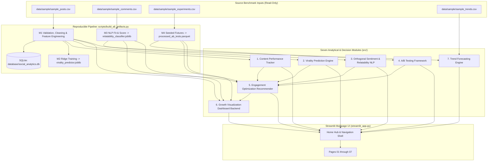

# SocialPulse — An Intelligent Social Media Analytics & Engagement Optimization Platform

[-3776AB.svg)](https://www.python.org/)
[](https://streamlit.io/)

[](LICENSE)

**SocialPulse** is a modular Python Data Science and Decision-Support platform designed to analyze audience relatability, high-intent engagement behavior, controlled creative experimentation, and cohort trajectory forecasting across short-form social media platforms (**Instagram Reels/Carousels** and **YouTube Shorts**).

**SocialPulse is an Unlox Major Project developed as part of an academic major-project initiative.**

---

## 📌 Executive Summary & Benchmark Scope

Conventional creator dashboards rely heavily on passive vanity metrics such as raw likes or unsegmented impressions. **SocialPulse** replaces guesswork with an evidence-tiered analytical pipeline prioritizing high-intent engagement signals (**Shares**, **Saves**, and **Watch Retention**) alongside strict statistical, temporal, and platform-isolation guardrails.

> **Important Provenance & Operational Mode:**
> SocialPulse operates in **Offline Synthetic Benchmark Mode**. Every derived dataset, serialized model, and interactive view is backed deterministically by curated multi-platform benchmark inputs in [`data/sample/`](data/sample/). Platform API connectors (`InstagramGraphAPIConnector`, `YouTubeDataAPIConnector`) and scraper interfaces (`SocialMediaScraper`) are contract/placeholder interfaces defining schema boundaries rather than live credentialed scrapers or OAuth clients.

---

## 🎓 Project Origin

SocialPulse is an Unlox Major Project developed as part of an academic major-project initiative, originally scoped as *"The Data-Driven Social Engagement Initiative."* The original problem statement document is archived at [`Problem_Statement/Data_Science_Major_Project_December.pdf`](Problem_Statement/Data_Science_Major_Project_December.pdf) and is redistributed in this repository with owner-confirmed permission for academic context and provenance.

From that academic specification, the codebase was engineered into a 7-module analytics, statistical experimentation, NLP, and walk-forward forecasting workspace operating deterministically over curated offline benchmark datasets.

---

## 🏗️ System Architecture & Core Modules



### Module Breakdown

1. **Content Performance Tracker (`src/data_ingestion/`, `src/preprocessing/`, `src/analytics/`)**
   * Enforces the canonical **14-field unified post schema** (`UNIFIED_POST_FIELDS`) via pure Python/pandas validation (`DataValidator`), nullable pandas types (`Int64`, `Float64`), and snapshot-preserving deduplication on `(platform, post_id, collection_timestamp)`.
   * Preserves missing-value semantics (e.g., YouTube has `<NA>` for `saves` and never zero-imputes unavailable metrics) while computing availability-aware completeness and isolated views- vs. reach-based engagement rates.
   * Persists processed outputs to Parquet/CSV and SQLite (`database/social_analytics.db` with `latest_posts` view).

2. **Virality Prediction Engine (`src/modeling/virality_predictor.py`)**
   * Computes an ex-post **Engagement Virality Index (EVI)** — an availability-aware high-intent density metric normalizing observed weights across `shares` (`0.40`), `saves` (`0.35`), `comments_count` (`0.15`), and `likes` (`0.10`):
     $$\text{EVI} = \frac{\sum_{m \in \text{avail}} \tilde{w}_m \cdot x_m}{\text{Exposure} + \epsilon} \times 1000 \times \phi$$
     where $\epsilon = 100.0$, $\text{Exposure}$ prefers `reach` $\rightarrow$ `views` $\rightarrow$ `impressions`, and video retention multiplier $\phi = 0.5 + \text{retention\_rate}$ (when valid in $[0, 1]$, else $1.0$).
   * Trains a target-leakage-guarded **Ridge Regressor** strictly on pre-publication features (`PRE_PUBLICATION_FEATURES`) filtered to settled mature posts ($\ge 7$ days old, $N = 112$) using chronological train/test partitioning ($89/23$ split), benchmarked against a `DummyRegressor` mean baseline (`MAE` $22.59$ vs $39.97$; `Spearman` $\rho = 0.616$, approximate empirical $\pm q_{95} = 50.16$ error band).

3. **Audience Sentiment & Relatability Analyzer (`src/nlp/`)**
   * Separates **Audience Identification (Relatability)** (`Relatable`, `Neutral`, `Uncertain`) from **Emotional Valence (Sentiment Polarity)** (`Positive`, `Negative`, `Neutral`, `Mixed`) as two orthogonal dimensions.
   * Relatability uses a **Multi-Tier Hybrid NLP Pipeline**:
     - *Layer 0 (Validation & Safety):* Discards empty text, flags insufficient context (pure emojis, short tokens), and detects non-English comments (`UNSUPPORTED_LANGUAGE`) rather than forcing English statistics.
     - *Layer 1 (Domain Heuristic Guardrails):* Filters technical camera/gear/music inquiries while anchoring explicit experiential phrases.
     - *Layer 2 (Statistical Classifier):* Sublinear TF-IDF word n-grams `(1, 2)` paired with class-weighted regularized Logistic Regression.
     - *Layer 3 (Uncertainty Boundary):* Flags ambiguous probabilities in $[0.42, 0.58]$ as `Uncertain`.
   * Sentiment uses a custom domain lexicon engine (`SentimentAnalyzer`) with negation flipping, intensifiers, and contrast weighting to classify `Positive`, `Negative`, `Neutral`, and `Mixed` valence without external VADER/TextBlob dependencies.
   * Benchmark results on `processed_comments.parquet`: `89.3%` Accuracy / `0.893` Macro F1 on strictly unique test texts ($N = 28$), and `90.4%` Accuracy / `0.903` Macro F1 across multi-post repeated rows ($N = 114$), paired with circularity and uncalibrated-probability disclosures in `app/pages/03_Sentiment_Analysis.py`.

4. **A/B Testing Framework (`src/statistics/ab_testing.py`)**
   * Separates randomized experiments from observational cohort comparisons (`ExperimentType`).
   * *Proportions & Rates:* Pooled two-proportion $z$-test, automatic **Fisher's exact test** fallback on sparse contingency tables, **Agresti–Caffo** adjusted confidence intervals, Cohen's $h$, and cluster-collapsed post-level rate testing (`compare_post_level_rates`) mitigating intra-post exposure clustering.
   * *Continuous Metrics:* Welch's unequal-variance $t$-test (Welch–Satterthwaite df), non-parametric Mann–Whitney $U$ stochastic-dominance diagnostic, and Hedges' $g$.
   * *Multiple Testing & Planning:* Holm–Bonferroni (FWER) and Benjamini–Hochberg (FDR) adjustments, IQR outlier auditing without silent deletion, and asymptotic sample-size / approximate achieved power estimators (`app/pages/04_AB_Testing.py`).

5. **Engagement Optimization Recommender (`src/recommender/`)**
   * Synthesizes Modules 1–4 into explainable, tiered actions across **HIGH** (adequately powered randomized trials, $p_{\text{adj}} < 0.05$, power $\ge 80\%$, $N \ge 60$), **MEDIUM** (controlled cohorts or temporally validated models), and **LOW / EXPLORATORY** (observational associations or proposed A/B experiments).
   * Ranks actions using a deterministic priority index:
     $$\text{Raw} = 0.30 S_{\text{evidence}} + 0.20 S_{\text{impact}} + 0.15 S_{\text{sample}} + 0.15 S_{\text{relevance}} + 0.10 S_{\text{recency}} + 0.10 S_{\text{quality}}, \quad \text{Priority} = \text{Raw} \times F_{\text{conflict}}$$
   * Detects observational-vs-experimental conflicts (applying $F_{\text{conflict}} = 0.85$) and drafts A/B validation proposals (`app/pages/05_Recommendations.py`).

6. **Growth Visualization Dashboard (`src/dashboard/growth_dashboard_backend.py` & `app/pages/06_Growth_Dashboard.py`)**
   * Unifies Modules 1–5 across seven interactive analytical sections: overview KPIs (pooled vs. post-mean rates & equal-duration period deltas), daily/weekly/monthly trends without false zero-imputation on undefined rates, normalized cross-platform comparison with non-equivalence disclosures, content feature & upload schedule matrices, audience NLP distribution & empirical Spearman disclosure ($\rho = 0.0044, p = 0.972$), A/B effect-size forest plot, and prioritized Module 5 recommendations. See [`docs/MODULE_6_GROWTH_DASHBOARD.md`](docs/MODULE_6_GROWTH_DASHBOARD.md).

7. **Trend Forecasting Engine (`src/modeling/trend_forecaster.py` & `app/pages/07_Trend_Forecasting.py`)**
   * Models **publication-cohort cumulative performance** ($y_t = \sum \text{Views}_i$) under explicit `~2–63` day exposure-age bias and `UNVERIFIED` ingestion coverage disclosures, strict platform isolation (YouTube 3-component `youtube_available_interactions`), and strict `NaN` engagement-rate rejection.
   * Evaluates 5 candidates (**Naive**, **Seasonal Naive**, **Moving Average**, **Holt's Damped Exponential Smoothing**, **AutoRegressive Ridge**) via leak-free rolling-origin walk-forward validation using scale-aware **MASE** and relative MAE, paired with horizon-specific uncalibrated empirical uncertainty spreads and selection-optimism disclosures. See [`docs/MODULE_7_TREND_FORECASTING.md`](docs/MODULE_7_TREND_FORECASTING.md).

---

## 📂 Verified Project Structure

```
SocialPulse/
│
├── .github/workflows/
│   └── ci.yml                                      <- Python 3.11 CI (build, validate, pytest, Streamlit smoke)
├── .streamlit/
│   └── config.toml                                 <- Light workspace + dark slate sidebar palette
├── Problem_Statement/
│   └── Data_Science_Major_Project_December.pdf     <- Original project brief
├── assets/
│   ├── socialpulse_icon.svg                        <- Compact sidebar mark
│   └── socialpulse_logo.svg                        <- Brand lockup
│
├── data/
│   ├── sample/                                     <- Tracked read-only benchmark inputs
│   │   ├── sample_posts.csv                        (121 snapshot rows / 120 unique posts)
│   │   ├── sample_comments.csv                     (500 benchmark comments)
│   │   ├── sample_experiments.csv                  (4 experiment definitions: EXP_001–EXP_004)
│   │   └── sample_trends.csv                       (170 daily struggle keyword volume records)
│   ├── processed/                                  <- Generated Parquet + CSV datasets (gitignored)
│   └── raw/                                        <- Raw staging directory (.gitkeep only)
│
├── database/
│   └── social_analytics.db                         <- Generated SQLite warehouse (gitignored)
│
├── models/                                         <- Generated .joblib weights (gitignored) & deterministic JSON metadata
│   ├── virality_predictor.joblib / virality_predictor_metadata.json
│   ├── relatability_classifier.joblib / relatability_metadata.json
│   └── build_provenance.json                       <- Local untracked runtime timestamps & input checksums (gitignored)
│
├── scripts/
│   ├── build_all_artifacts.py                      <- Idempotent build & verification orchestrator
│   ├── generate_ab_test_fixtures.py                <- Seeded Module 4 observation generator
│   ├── train_and_benchmark_nlp.py                  <- Module 3 trainer & benchmark evaluator
│   └── audit_module3.py                            <- Standalone Module 3 diagnostic script
│
├── src/
│   ├── analytics/engagement_metrics.py
│   ├── dashboard/growth_dashboard_backend.py
│   ├── data_ingestion/                             <- api_connectors, data_scraper, data_validator,
│   │                                                  sample_ingestion, schemas, storage
│   ├── modeling/                                   <- virality_predictor, trend_forecaster
│   ├── nlp/                                        <- relatability_classifier, sentiment_analyzer, text_preprocessor
│   ├── preprocessing/                              <- cleaning, feature_engineering
│   ├── recommender/                                <- content_recommender, engine, schemas
│   └── statistics/ab_testing.py
│
├── streamlit_app.py                                <- SOLE RECOMMENDED UI ENTRYPOINT (navigation + branding)
├── app/
│   ├── streamlit_app.py                            <- SocialPulse Hub landing view (loaded by root entrypoint)
│   ├── components/ui_widgets.py                    <- Shared cards, badges, Plotly theme & CSS
│   └── pages/
│       ├── 01_Content_Performance.py
│       ├── 02_Virality_Prediction.py
│       ├── 03_Sentiment_Analysis.py
│       ├── 04_AB_Testing.py
│       ├── 05_Recommendations.py
│       ├── 06_Growth_Dashboard.py
│       ├── 06_Growth_Analytics.py                  <- Legacy compatibility redirect -> 06_Growth_Dashboard.py
│       └── 07_Trend_Forecasting.py
│
├── notebooks/                                      <- Exploratory notebooks ONLY (unexecuted; 0 stored cell outputs)
│   ├── 01_eda_and_metrics.ipynb
│   ├── 02_virality_modeling.ipynb
│   ├── 03_nlp_sentiment_training.ipynb
│   ├── 04_ab_testing_analysis.ipynb
│   └── 05_trend_forecasting.ipynb
│
├── docs/
│   ├── MODULE_6_GROWTH_DASHBOARD.md
│   └── MODULE_7_TREND_FORECASTING.md
├── tests/                                          <- 16 automated pytest modules (196 tests)
├── utils/                                          <- Project root & YAML config loader helpers
├── config.yaml                                     <- Static reference configuration snapshot (not read by runtime)
├── constraints.txt                                 <- Verified Python 3.11.9 exact package constraints (cross-OS safe)
├── LICENSE                                         <- MIT License (project-owned code & eligible assets)
├── requirements.txt                                <- Core runtime dependencies
├── requirements-dev.txt                            <- Runtime + pytest + exploratory notebook packages
└── README.md
```

---

## 🚀 Setup, Reproducible Build & Launch

### 1. Prerequisites
* **Python 3.11+** recommended (verified on **Python 3.11.9** with `scikit-learn 1.9.0`, `pandas 3.0.3`, `streamlit 1.58.0`).
* Note for Python 3.10 users: `pip` resolves compatible `pandas 2.x` and earlier `scikit-learn` wheels; run `python scripts/build_all_artifacts.py` after installing dependencies to rebuild local `.joblib` models matching your installed `scikit-learn` version.

### 2. Virtual Environment & Dependency Installation

#### Windows PowerShell
```powershell
# Clone from GitHub (or navigate to your local SocialPulse directory):
# git clone https://github.com/SarthakPandey84/Social-Pulse.git SocialPulse
cd "path\to\SocialPulse"

python -m venv .venv

# If script execution is restricted in PowerShell for the current session:
Set-ExecutionPolicy -Scope Process -ExecutionPolicy Bypass

.\.venv\Scripts\Activate.ps1

# Install core runtime dependencies (recommended with verified Python 3.11 constraints):
pip install -r requirements.txt -c constraints.txt

# Or install runtime + pytest + Jupyter/plotting dependencies:
pip install -r requirements-dev.txt -c constraints.txt

# Flexible range installation without constraints is also supported on Python >=3.11:
# pip install -r requirements.txt
```

#### Linux / macOS (Bash / Zsh)
```bash
# git clone https://github.com/SarthakPandey84/Social-Pulse.git SocialPulse
cd SocialPulse
python3 -m venv .venv
source .venv/bin/activate
pip install -r requirements.txt -c constraints.txt
```

> **Dependency Policy:** [`requirements.txt`](requirements.txt) and [`requirements-dev.txt`](requirements-dev.txt) preserve tested bounded version ranges, while [`constraints.txt`](constraints.txt) pins the exact verified Python 3.11.9 package closure (`platform`/`os` markers scope Windows-only packages cleanly for Linux CI).

### 3. Rebuild All Runtime Artifacts (From Clean Checkout)
Because generated datasets (`data/processed/*`), trained binaries (`models/*.joblib`), `models/build_provenance.json`, and `database/social_analytics.db` are excluded in `.gitignore`, you **must** build them first from `data/sample/` before launching the Streamlit application:

```powershell
# 1) Validate sample CSVs, regenerate processed Parquet/CSV files, SQLite DB, and models,
#    and run post-build schema, SQLite, and model-inference checks:
python scripts/build_all_artifacts.py

# Optional: validate an already-built workspace without regenerating files:
python scripts/build_all_artifacts.py --validate-only
```

> **Deterministic Metadata & Runtime Provenance Policy:**
> - **Tracked deterministic metadata** ([`models/virality_predictor_metadata.json`](models/virality_predictor_metadata.json) and [`models/relatability_metadata.json`](models/relatability_metadata.json)) excludes intentionally volatile execution timestamps (`trained_at`) and uses normalized LF line endings so repeated builds produce byte-identical tracked outputs.
> - **Intentionally variable runtime provenance fields** (`built_at_utc`, `virality_model_trained_at_utc`, `nlp_model_trained_at_utc`, `analysis_timestamp`, `generated_at`) capture real execution timestamps in-memory or in local untracked [`models/build_provenance.json`](models/build_provenance.json) alongside source CSV SHA-256 digests.

### 4. Launch the SocialPulse Application
After `python scripts/build_all_artifacts.py` completes, launch from the repository root (`SocialPulse/`) using the unified entrypoint:

```powershell
streamlit run streamlit_app.py
```

Open **`http://localhost:8501`** in your browser.
> Launch using **`streamlit run streamlit_app.py`** (do not launch `app/streamlit_app.py` directly, as the root entrypoint initializes `st.navigation`, `st.logo`, and global CSS styling via `inject_global_styles()`).

---

## 🧪 Automated Test Suite & CI

With `requirements-dev.txt` (and `constraints.txt`) installed, run all **196 automated tests** across Modules 1–7, Phase 3 optimizations, Phase 4 UI shell & views, HTML escaping, NLP failure-handling, metadata reproducibility, and the artifact build pipeline:

```powershell
pytest tests/ -v
```

GitHub Actions ([`.github/workflows/ci.yml`](.github/workflows/ci.yml)) automates this pipeline on `ubuntu-latest` with **Python 3.11**: installing dependencies via `requirements-dev.txt` + `constraints.txt` (`pip check`), executing `python scripts/build_all_artifacts.py`, verifying zero Git drift on tracked `models/*_metadata.json`, running `--validate-only`, verifying zero compile `SyntaxWarning`/`DeprecationWarning` issues, executing `pytest tests/ -v`, and running a headless `streamlit run streamlit_app.py` health smoke check (`/_stcore/health`).

---

## ⚠️ Known Limitations & Governance Disclosures

1. **Synthetic Offline Benchmark Data:** Included CSV fixtures demonstrate end-to-end statistical, NLP, experimental, and forecasting mechanics; results do not represent empirical measurements from live production creator accounts.
2. **Placeholder Ingestion Interfaces:** `src/data_ingestion/api_connectors.py` and `src/data_ingestion/data_scraper.py` define schema-compliant interfaces (`status="placeholder"`) without live OAuth/graph credentials or automated browser scraping.
3. **Artifact Precondition for Page 03:** Run `python scripts/build_all_artifacts.py` before opening `03. Sentiment & Relatability` from a fresh checkout (`build_all_artifacts.py` succeeds standalone prior to launching Streamlit and generates `processed_comments.parquet` + NLP models directly from `data/sample/`; opening Page 03 beforehand falls back to raw `sample_comments.csv`, raising `KeyError: 'relatability_label'`).
4. **Static `config.yaml` & Exploratory Notebooks:** `config.yaml` is maintained as a documented reference snapshot; analytical modules use explicit Python constants and schemas. The five notebooks in `notebooks/` are unexecuted exploratory references (`0` stored cell outputs).
5. **Uncalibrated Uncertainty Bounds:** Residual prediction intervals in Modules 2 and 7 reflect historical dispersion / empirical quantiles rather than calibrated conformal coverage guarantees.

---

## 📄 License

Project-owned source code, automated tests, pipeline scripts, project documentation, synthetic benchmark datasets (`data/sample/*.csv`), and eligible SVG/UI assets in this repository are licensed under the **MIT License** (`Copyright (c) 2026 Sarthak Pandey`). See [`LICENSE`](LICENSE) for the full license text.

**Scope & Exclusions:**
- The MIT License covers only project-owned code and eligible repository assets created for SocialPulse.
- Third-party dependencies listed in [`requirements.txt`](requirements.txt) and [`requirements-dev.txt`](requirements-dev.txt) remain governed by their respective upstream open-source licenses.
- The external academic problem statement document [`Problem_Statement/Data_Science_Major_Project_December.pdf`](Problem_Statement/Data_Science_Major_Project_December.pdf) originates from the Unlox Major Project brief and is **not** covered by the MIT License; it is retained and redistributed in this repository with owner-confirmed permission solely for academic context and provenance.
