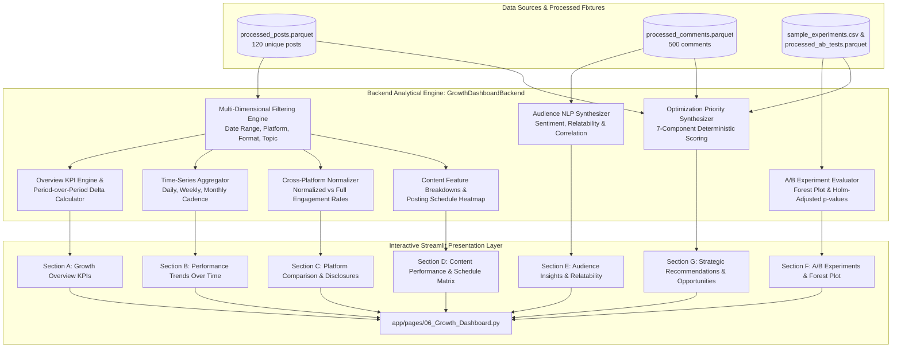

# Module 6: Growth Visualization Dashboard Documentation

**Product:** *SocialPulse — An Intelligent Social Media Analytics & Engagement Optimization Platform*  
*(Unlox Data-Driven Social Engagement Initiative)*  
**Module:** 6 — Growth Visualization Dashboard  
**Status:** Audited, Methodologically Verified, and Locked (22/22 Module 6 Tests Passing; 186/186 Total Repository Tests Passing)

---

## 1. Overview & Core Objective

Module 6 brings together the analytical, predictive, natural language, and experimental outputs of Modules 1 through 5 into an interactive **Growth Visualization Dashboard**. 

The dashboard provides creators and data analysts with descriptive performance trends, normalized platform comparisons, content feature breakdowns, audience sentiment distributions, controlled A/B experiment evaluations, and prioritized strategic recommendations.

Crucially, the dashboard is built with strict statistical and causal guardrails:
- **Observational vs. Experimental Separation:** Observational patterns (e.g., weekend posting views, duration buckets) are explicitly labeled with non-causal warnings and never conflated with controlled causal effects.
- **Strict Metric Denominator Integrity:** Views-based and reach-based engagement rates are isolated to their proper mathematical denominators and never mixed across incompatible platforms.
- **Data Provenance Disclosures:** Prominent dashboard-wide notices disclose that all analytics are demonstrated using synthetic benchmark fixtures.

---

## 2. Dashboard Architecture & Integration Flow



---

## 3. Data Integration Map Across Modules 1–5

| Section / Capability | Source Module | Input Dataset / API | Key Fields Used | Mathematical Definition / Methodology | Limitations & Caveats |
| :--- | :--- | :--- | :--- | :--- | :--- |
| **Section A: Growth Overview** | Module 1 | `data/processed/processed_posts.parquet` | `views`, `impressions`, `reach`, `likes`, `comments_count`, `shares`, `saves`, `new_followers` | Deduplicated to latest post snapshots via `get_latest_posts_view()`. Distinguishes Pooled Views Rate ($\frac{\sum \text{Interactions}}{\sum \text{Views}} \times 100\%$) from Arithmetic Mean of Post Rates ($\frac{1}{N}\sum \frac{\text{Interactions}_i}{\text{Views}_i} \times 100\%$). | YouTube lacks saves and reach; reach-based rate is computed only across posts where $\text{reach} > 0$. |
| **Period Comparison** | Module 6 Backend | `processed_posts.parquet` | `timestamp_dt` | Evaluates equal-duration comparison windows ($D$ calendar days); handles missing posting dates and zero-activity prior periods without division by zero. Requires $\ge 5$ posts per period. | Incomplete periods are rejected and never presented as equivalent. |
| **Section B: Trends Over Time** | Module 1 | `processed_posts.parquet` | `timestamp_dt`, `views`, `likes`, `shares`, `saves` | Resampled by Daily (`D`), Weekly (`W`), or Monthly (`ME`). Continuous rates use `NaN` rather than false `0.0` for intervals with `0` views. | Aggregation reflects publication timestamp, not cumulative daily view drift. |
| **Section C: Platform Comparison** | Module 1 | `processed_posts.parquet` | `platform`, `content_type`, `views`, `shares`, `saves` | Normalized Rate = $\frac{\text{Likes} + \text{Comments} + \text{Shares}}{\text{Views}} \times 100\%$. Full Rate adds Saves. Explicit non-equivalence disclosures warn that mathematical alignment does NOT imply behavioral equivalence. | Cross-platform rankings use Normalized Rate to prevent penalizing YouTube for lack of save tracking. Discloses distinct interaction fields and denominators per platform. |
| **Section D: Content Breakdowns** | Module 1 & 2 | `processed_posts.parquet` | `topic`, `content_type`, `duration_seconds`, `hook_type`, `posting_hour` | Grouped means and sample size annotations ($N$). Hourly vs. Day-of-Week heatmap matrix of mean views. Safe bubble chart clipping avoids `NaN` marker errors. | Observational associations; confounding variables prevent causal interpretation. |
| **Section E: Audience Insights** | Module 3 | `data/processed/processed_comments.parquet` | `sentiment_label`, `relatability_label`, `post_id` | Donut distributions of sentiment and relatability. Post-level merge for Spearman correlation with saves ($\rho = 0.0044, p = 0.972$). Exact disclaimer avoids causal overreach. | Rule-based heuristics and TF-IDF classifiers trained on synthetic benchmark fixtures; not verified human ground truth. Does not establish equivalence or prove absence of effect. |
| **Section F: A/B Experiments** | Module 4 | `sample_experiments.csv` & `processed_ab_tests.parquet` | `variant`, `share_rate`, `views`, `relatability_pct` | `ABTestingFramework.compare_continuous()`, `compare_post_level_rates()`, Holm-Bonferroni correction, Forest Plot of effect sizes & 95% CIs. | Post-level aggregation addresses exposure dependence within posts, but does not correct across-post creator/campaign clustering. |
| **Section G: Strategy Optimization** | Module 5 | `OptimizationRecommender` | Integrated Modules 1–4 signals | 7-component deterministic Priority Score formula with conflict penalties and confidence hierarchy (`HIGH`, `MEDIUM`, `LOW`/`EXPLORATORY`). | Deterministic ranking index only; does NOT represent a calibrated probability of virality or success. |

---

## 4. Key Performance Indicators (KPIs) & Mathematical Definitions

1. **Total Posts ($N$):** Count of unique content assets published in the selected period (deduplicated against repeated collection snapshots via `get_latest_posts_view()`).
2. **Views-Based Engagement Rate:**
   $$\text{Rate}_{\text{views}} = \frac{\text{Likes} + \text{Comments} + \text{Shares} + \text{Saves}}{\text{Total Views}} \times 100\%$$
3. **Reach-Based Engagement Rate (Instagram):**
   $$\text{Rate}_{\text{reach}} = \frac{\text{Likes} + \text{Comments} + \text{Shares} + \text{Saves}}{\text{Total Reach}} \times 100\% \quad (\text{for posts with } \text{Reach} > 0)$$
4. **Normalized Cross-Platform Engagement Rate:**
   $$\text{Rate}_{\text{norm}} = \frac{\text{Likes} + \text{Comments} + \text{Shares}}{\text{Total Views}} \times 100\%$$
5. **Share Rate:**
   $$\text{Rate}_{\text{shares}} = \frac{\text{Shares}}{\text{Total Views}} \times 100\%$$
6. **Save-to-Share Ratio:**
   $$\text{Ratio} = \frac{\text{Saves}}{\max(1, \text{Shares})}$$

---

## 5. Global Filtering & Interactivity

The dashboard includes a dedicated sidebar with synchronized multi-dimensional filters:
- **Date Range Picker:** Constrained by the dataset boundaries (2026-09-01 to 2026-10-31).
- **Platform Selector:** Filter to `All Platforms`, `Instagram`, or `YouTube`.
- **Content Format Selector:** Filter to `All Formats`, `Reel`, `Carousel`, or `Short Video`.
- **Struggle Topic Selector:** Filter to `All Topics` or specific topics (e.g. `Social Anxiety`, `Career Burnout`).
- **Reset Button:** Instantly restores all filter defaults.
- **Empty State Safeguards:** If an overly narrow filter combination yields 0 matching posts, a clear warning is displayed, preventing division-by-zero crashes or distorted empty plots.

---

## 6. Testing & Quality Assurance

The module is verified by a dedicated 22-test automated regression suite in `tests/test_module6_dashboard.py`:

```text
tests/test_module6_dashboard.py::test_data_loading_from_all_modules PASSED
tests/test_module6_dashboard.py::test_correct_kpi_calculations PASSED
tests/test_module6_dashboard.py::test_engagement_rate_denominator_integrity PASSED
tests/test_module6_dashboard.py::test_time_series_aggregation_cadences PASSED
tests/test_module6_dashboard.py::test_date_range_filtering PASSED
tests/test_module6_dashboard.py::test_platform_filtering PASSED
tests/test_module6_dashboard.py::test_content_category_filtering PASSED
tests/test_module6_dashboard.py::test_missing_value_handling_youtube_metrics PASSED
tests/test_module6_dashboard.py::test_empty_data_behavior PASSED
tests/test_module6_dashboard.py::test_synthetic_data_provenance_propagation PASSED
tests/test_module6_dashboard.py::test_incompatible_platform_metric_normalization PASSED
tests/test_module6_dashboard.py::test_experiment_performance_data_integrity PASSED
tests/test_module6_dashboard.py::test_recommendation_integration_module5 PASSED
tests/test_module6_dashboard.py::test_consistency_between_kpi_and_chart_data PASSED
tests/test_module6_dashboard.py::test_regression_compatibility_modules_1_to_5 PASSED
tests/test_module6_dashboard.py::test_relatability_interpretation_disclaimer PASSED
tests/test_module6_dashboard.py::test_pooled_vs_arithmetic_mean_engagement_rates PASSED
tests/test_module6_dashboard.py::test_period_comparison_equal_duration_and_incomplete_detection PASSED
tests/test_module6_dashboard.py::test_period_comparison_zero_activity_in_previous_period PASSED
tests/test_module6_dashboard.py::test_cross_platform_disclosures_and_non_equivalence PASSED
tests/test_module6_dashboard.py::test_zero_denominators_safety PASSED
tests/test_module6_dashboard.py::test_missing_saves_handling PASSED
```

**Full Repository Regression Suite:** **186 passed across Modules 1–7, UI shell, and artifact build verification.**

---

## 7. Runtime & Visual Verification History

* **Backend Analytical & UI Smoke Verification:** Verified continuously via `tests/test_module6_dashboard.py` (22/22) and Streamlit `AppTest` checks in `tests/test_phase4_ui.py` using the active multi-page entrypoint (`streamlit run streamlit_app.py`).
* **UI Modernization & Responsive Chart Layouts:** Visually verified across Desktop (`1440×900`), Laptop (`1366×768`), Tablet (`768×1024`), and Mobile (`390×844`) viewports during Phases 4, 4.1, and 4.2 without label/title clipping or runtime exceptions.
* **Repository Cleanup Note:** Superseded pre-Phase 4 CDP runtime screenshot captures formerly stored under `reports/figures/module6_runtime/` were pruned during the Phase 5B repository cleanup to keep the release workspace lean and avoid outdated visual documentation.
